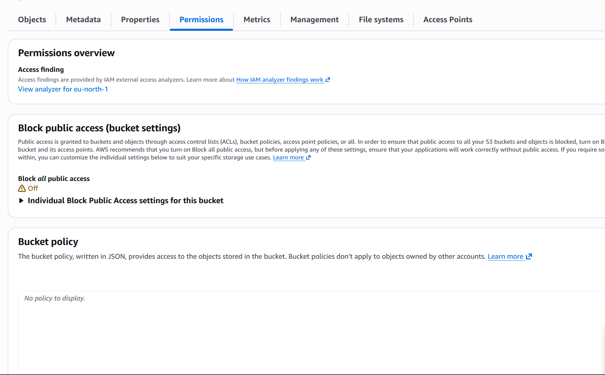
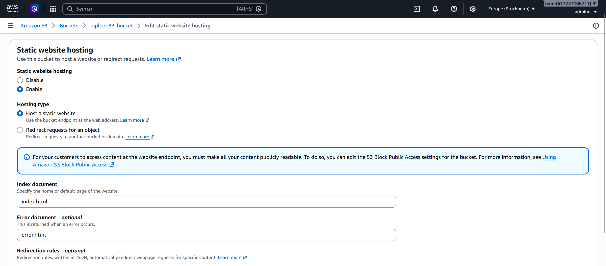
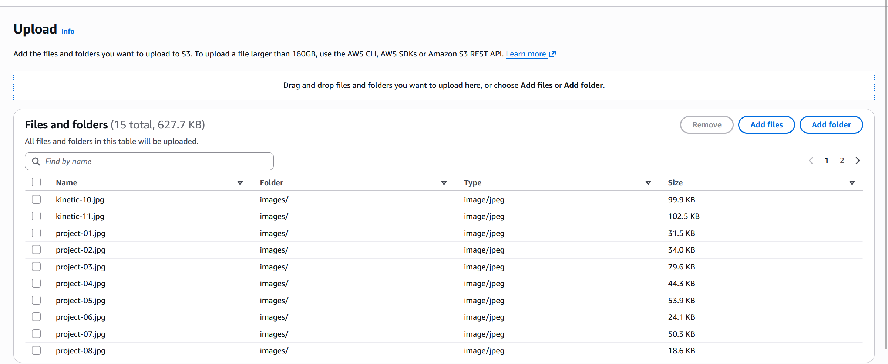
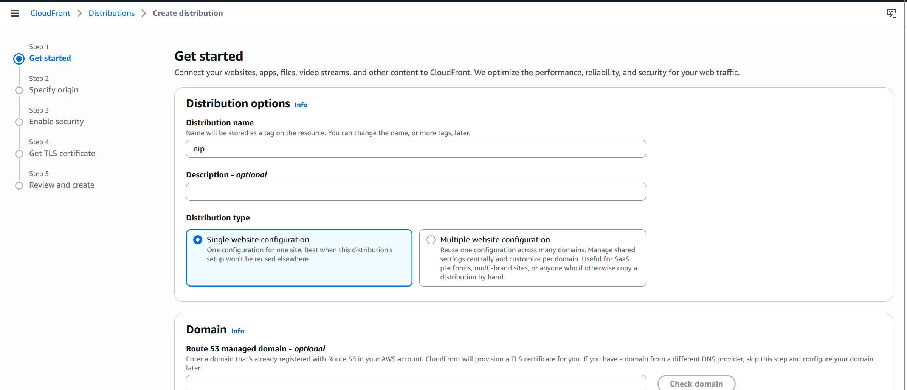
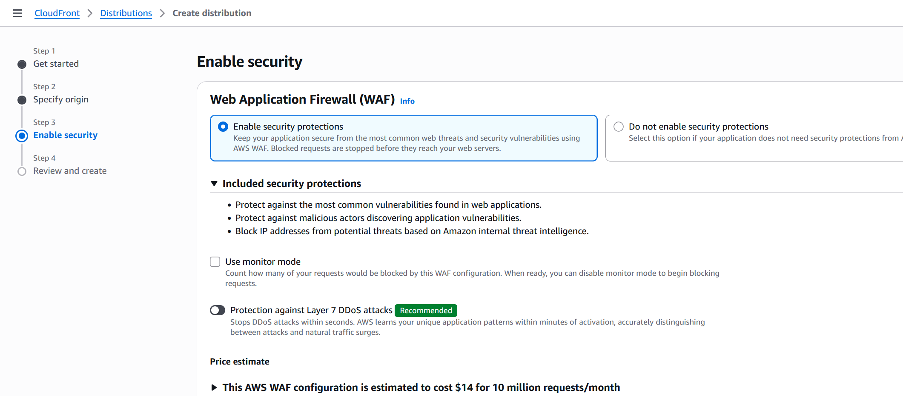

SETTING UP S3 BUCKET WITH STATIC WEBSITE ENABLED
1. Type s3 on the AWS search bar
2. click create bucket

4. choose bucket type
5. Bucket name - specify your Bucket name or choose bucket if you have an existing bucket
6. uncheck "Block all public access"

7. check "I acknowledge that the current settings might result in this bucket and the objects within becoming public."
8. leave all other settings to default and click create bucket
9. click properties after bucket is successfully created, scroll down to static website hosting, click edit button on static website hosting and enable

10. leave hosting type @ "Host a static website"
10.type "index.html" on the Index document slot and "error.html" on the Error document slot and save changes
11.Go back to your bucket and click Upload

12.click Add files to and select the html files of your website and upload
13.click add folder and select the image folder of your website and upload
14.Upload
15.close
16.Go to bucket and click permission
17.edit Bucket policy
18.create Bucket policy

19.Go to properties,copy "Bucket website endpoint"
20.open new browser tab and paste your "Bucket website endpoint" to verify your configuration can be publicly viewed

SET UP CLOUDFRONT FOR S3 BUCKET
1. Type CloudFront on the AWS search bar
2. click "create distribution"
3. create Distribution name

4. choose Distribution type
5. click Next
6. Specify Origin "choose origin type"
7. Origin:s3 origin: click browse origin
8. choose your created bucket
9. click "Use Website Endpoint" If you plan to use this distribution as a website
10.Enable Security: Select "Enable Security Protection"

11.click next
12.Review and Create
13.create Distribution
14.copy distribution domain name and paste in paste in browser to test configuration
